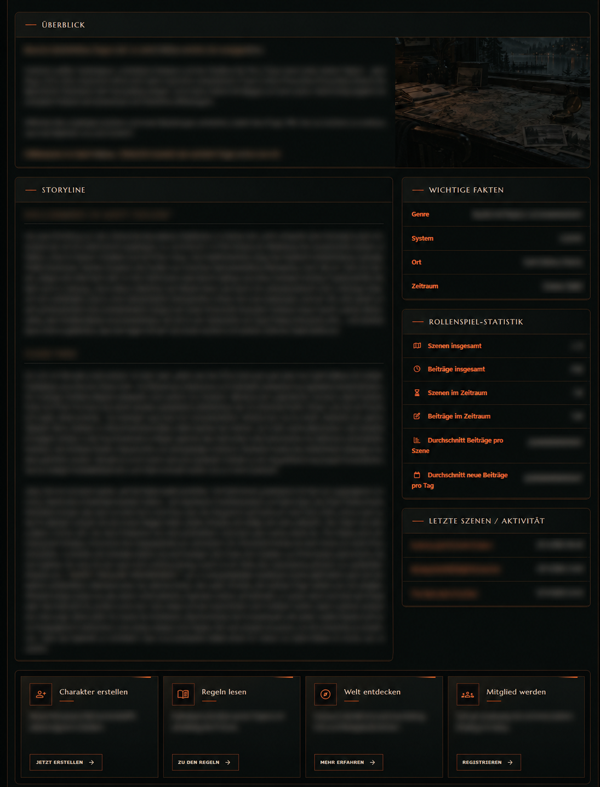

# Storyline Overview für MyBB

Ein neutrales MyBB-Plugin für Rollenspielforen. Es stellt eine frei pflegbare Storyline-Seite mit Fakten, Inplay-Statistik, zuletzt aktiven Szenen und bis zu vier Link-Kacheln bereit.

## Praxisbeispiel aus einem laufenden Forum

Das folgende Bild zeigt die individuell konfigurierte Storyline-Seite des aktiven Rollenspielforums **Saint Hollow**. Diese forumspezifische Ausgangsfassung diente als Grundlage für die neutrale Veröffentlichung.

Konkrete Storyline-Texte, Faktenwerte, Szenennamen und Beschreibungen wurden für die öffentliche Vorschau stark verschwommen dargestellt. Das öffentliche Plugin enthält weder diese Inhalte noch das Saint-Hollow-Design.

Sichtbar bleiben ausschließlich Aufbau und Funktionsbereiche: Überblick, ausführliche Storyline, wichtige Fakten, Inplay-Statistik, letzte Szenen und frei belegbare Link-Kacheln.

## Funktionen

- Storyline und Überblick als frei pflegbare HTML-Inhalte
- Genre, Rating/System, Ort und Zeitraum als kompakte Fakten
- Statistiken für frei gewählte Inplay-Foren
- zuletzt aktive Szenen innerhalb eines einstellbaren Zeitraums
- vier frei konfigurierbare Link-Kacheln
- optionales Header- und Seitenhintergrundbild
- responsive, theme-neutrale Anordnung ohne eigene Farben oder Schriften
- berücksichtigt die MyBB-Forenrechte des jeweiligen Besuchers

## Voraussetzungen

- MyBB 1.8.x
- PHP-Version passend zur eingesetzten MyBB-Version
- optional Font Awesome im Theme für selbst eingetragene Kachel-Icons

Das Plugin ist eigenständig und benötigt **Ladytime Core nicht**.

Die mitgelieferte CSS-Datei regelt nur Raster, Abstände, Ausrichtung und mobile Umbrüche. Farben, Flächen, Rahmen, Schrift und Buttons stammen aus den MyBB-Standardklassen `tborder`, `thead`, `trow1`, `trow2`, `smalltext` und `button` des jeweils aktiven Themes.

## Installation

1. Den Inhalt des Ordners `Upload` in das Hauptverzeichnis der MyBB-Installation kopieren.
2. Im Admin-CP unter **Konfiguration → Plugins** das Plugin **Storyline Overview** installieren und aktivieren.
3. Unter **Konfiguration → Einstellungen → Storyline Overview** die Inhalte und die IDs der gewünschten Inplay-Foren eintragen.
4. Die Seite über `misc.php?action=storyline` öffnen.

Der Action-Name kann in den Einstellungen geändert werden. Eine Navigation oder ein Menülink wird bewusst nicht automatisch verändert; verlinke die Seite an der gewünschten Stelle in deinem Theme.

## Aktualisierung

Die Dateien aus `Upload` ersetzen. Bereits gespeicherte Inhalte bleiben erhalten. Nach einem Versionswechsel das Plugin einmal deaktivieren und wieder aktivieren, damit Templates und Einstellungen aktualisiert werden.

## Deinstallation

Die Deinstallation im Admin-CP entfernt die Plugin-Einstellungen und Templates. Sichere individuell eingetragene Storyline-Inhalte vorher, wenn du sie behalten möchtest.

## Sicherheit und Sichtbarkeit

Die Statistik und die Liste letzter Szenen berücksichtigen `canview`, `canviewthreads`, Forenpasswörter und inaktive Foren für den jeweils angemeldeten Besucher. Inhalte aus nicht zugänglichen Foren werden nicht ausgegeben.

Die beiden großen Textfelder erlauben absichtlich HTML und sollten deshalb nur von vertrauenswürdigen Administratorinnen und Administratoren gepflegt werden.

## Lizenz

[MIT](LICENSE) – veröffentlicht von [Ladytime](https://github.com/ladyfuchur-star).

